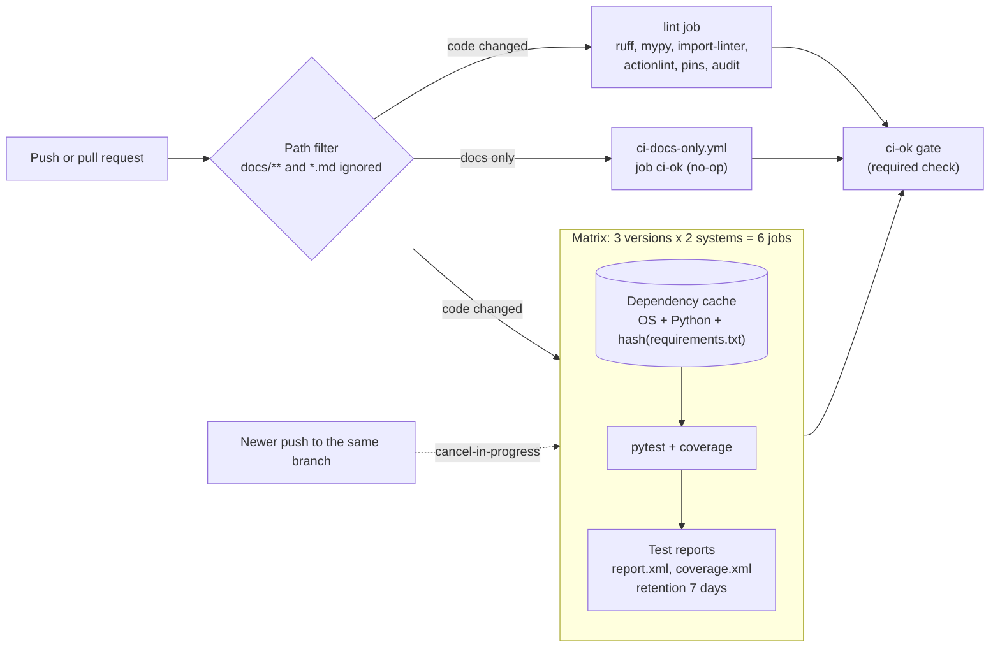

# Architecture: the fast CI workflow

This document describes what is in this repository and why it is shaped this way. Component names match the diagram in the lesson ("The fast CI workflow you build"): **Push or pull request**, **Path filter**, **Matrix** (3 versions x 2 systems = 6 jobs), **Dependency cache** and **Test reports**.

## Components and what each owns

| Component (lesson diagram) | Where it lives | What it owns |
| --- | --- | --- |
| **Push or pull request** | `on:` and `concurrency:` of [`ci.yml`](.github/workflows/ci.yml) | Starts the run. The concurrency group `ci-<ref>` lets one run per branch go at a time; `cancel-in-progress` is true on every ref except `main`. |
| **Path filter** | `paths-ignore` of `ci.yml`, `paths` of [`ci-docs-only.yml`](.github/workflows/ci-docs-only.yml) | Decides, on GitHub's side before any runner starts, that a change to `docs/**` or `*.md` starts no test job. Modeled by [`pipeline/pathfilter.py`](pipeline/pathfilter.py) so the tests can assert it. |
| **Matrix** | job `test` of `ci.yml` | Three quoted Python versions times two operating systems, `fail-fast: false`, `defaults.run.shell: bash` so one set of commands works on both systems. |
| **Dependency cache** | `cache: pip` and `cache-dependency-path: requirements.txt` on `actions/setup-python` | The pip download cache, keyed on the operating system, the interpreter and a hash of the lock file. Modeled by [`pipeline/cache_key.py`](pipeline/cache_key.py). |
| **Test reports** | the last step of `test` | `report.xml` (JUnit) and `coverage.xml` uploaded as `reports-<os>-<python>` with `if: always()`, seven-day retention and `if-no-files-found: error`. [`pipeline/slowest_tests.py`](pipeline/slowest_tests.py) also writes the five slowest tests to the job summary. |
| **Gate** (not in the diagram) | job `ci-ok` of `ci.yml`, [`pipeline/gate.py`](pipeline/gate.py) | The single check to require for `main`. Reads the `needs` context from an environment variable. |
| **Measurement** (not in the diagram) | [`measure-*.yml`](.github/workflows), [`pipeline/billing.py`](pipeline/billing.py) | The three "before" workflows started by hand, and the arithmetic of wall time and billable minutes. |
| **The library under test** | [`src/mathkit`](src/mathkit) | `domain` (arithmetic, statistics, the `ColumnSummary` value object, named errors), `application` (the `SummarizeTable` use case and the `ColumnSource` port), `infrastructure` (the pandas adapter), `interfaces` (the command line). |

## Pattern: pipeline as code with the logic in tested scripts

Anything in a workflow that is more than one command lives in `pipeline/` as a typed Python module with unit tests, and the workflow calls it: the gate, the summary table, the billing arithmetic, the cache-key model, the path-filter model and the pin check. Workflow YAML stays declarative. That keeps the part GitHub runs and the part the tests run the same code, and it is what makes the workflow's behavior testable on a laptop. Declarative facts that cannot run locally (the matrix, the retention, the concurrency expression) are asserted by [`tests/pipeline/test_workflows.py`](tests/pipeline/test_workflows.py), which is the lesson's review checklist as code. The library follows the usual layering and import-linter enforces it.

## Data flow

Drawn versions of this figure and of the walk-through: [the architecture](docs/diagrams/architecture.svg) and [one run](docs/diagrams/flow.svg).

### One run, step by step (a push of a code change to a pull request branch)

1. The push matches the `pull_request` trigger. At least one changed file is outside `docs/**` and `*.md`, so the path filter lets the workflow start.
2. GitHub joins the concurrency group `ci-refs/pull/7/merge`. If an older run of the same group is in progress, it is canceled ("Canceling since a higher priority waiting request exists").
3. `lint` and the six `test` jobs start in parallel on separate runners. Every job has `permissions: contents: read` and a timeout.
4. In each `test` job `actions/setup-python` computes the cache key `setup-python-<OS>-<arch>-python-<version>-pip-<hash of requirements.txt>`. A hit restores pip's download cache; a miss runs the install in full and saves the cache when the job ends.
5. `pip install --require-hashes -r requirements.txt` installs numpy, pandas and the test tools from the cache, verifying every hash.
6. `pytest` runs about 90 tests (library and pipeline scripts) and writes `report.xml` and `coverage.xml`.
7. With `if: always()` the job summary gets the slowest tests, and the two files are uploaded as `reports-<os>-<python>`, even when step 6 failed.
8. `ci-ok` runs with `if: always()`, reads `needs` from `NEEDS`, and fails if `lint` or any matrix job failed or was canceled. This is the one check the branch rule requires.

## Decisions and trade-offs

**A gate job instead of six required names.** Required checks match by name; the matrix names change with the matrix. See [ADR 0001](docs/adr/0001-one-gate-job-and-a-companion-for-docs-only-changes.md) for the companion workflow that covers documentation-only changes, and its one unverified edge (a change that mixes docs and code starts both).

**`fail-fast: false`.** The purpose of the matrix is the picture of which combinations are broken. The cost is that a broken commit still spends the minutes of all six jobs.

**No cancellation on `main`.** `cancel-in-progress: ${{ github.ref != 'refs/heads/main' }}`. On a branch only the newest commit matters; on `main` every commit must finish its tests, or an untested commit could be shipped.

**Built-in cache of `setup-python` instead of `actions/cache`.** One line, key built from the right inputs, and the log line that proves a hit. `actions/cache` would let the key be customized, which this project does not need.

**Hash-pinned universal lock** ([ADR 0002](docs/adr/0002-hash-pinned-universal-lock-files.md)). One file for six cells, verified by hash at install.

**Every action pinned to a full commit SHA, with the version in a comment.** A tag can be moved by its owner; a SHA cannot. [`pipeline/pins.py`](pipeline/pins.py) fails `make lint` and a test when one is not. Dependabot proposes new SHAs weekly.

**Measurement by separate workflows** ([ADR 0003](docs/adr/0003-measure-each-stage-with-its-own-workflow.md)).

**Least privilege.** Workflow-level `contents: read`, restated on each job; `persist-credentials: false` on every checkout, so the token is not left in the git config for later steps; the gate's output reaches the script through an environment variable, never through the shell text.

## Failure modes the lesson teaches, and how the code shows them

| Failure | What you see | How to reproduce |
| --- | --- | --- |
| **One combination breaks** | One red job of six; the other five still finish and upload reports. | `make run-fail` (act, three Ubuntu legs, Python 3.10 fails on purpose), or set the repository variable `DEMO_FAIL_ON_PYTHON=3.10` on GitHub and push. |
| **A stale cache** | After changing a pin in `requirements.txt` the first run misses and the install is slow again. | `python -m pipeline.cache_key` before and after editing a pin, and the log of `setup-python` on GitHub. |
| **Reports missing on failure** | Without `if: always()` the failing job has no artifact. | Remove the line; `tests/pipeline/test_workflows.py` fails first. |
| **A required check that never reports** | A documentation pull request waits for ever. | `ci-docs-only.yml` removes it; delete that file and open a docs-only pull request to see it. |
| **Cancellation of `main`** | A commit on `main` is canceled by the next one. | Change the expression to `true`; the workflow test fails. |

## Limits of the teaching build against production

- The measurement table needs real GitHub-hosted runs, so this repository ships the tool and a fixture-based worked example; the numbers for the owner's account are filled in after the first push.
- `act` cannot run Windows jobs, GitHub's path filters, concurrency or the real cache service; the local run covers the Ubuntu legs and the workflow logic, the rest is covered by the model modules and the structure tests.
- The library is small on purpose; the heavy dependencies (numpy, pandas) are there to make the cache matter.
- A production monorepo would add a dependency graph so only affected packages are tested, remote build caching, and larger runners where the measured payoff exists.

## How to extend it

- **A fourth Python version:** add it to the matrix list in `ci.yml` and to `measure-2-matrix.yml` and `measure-3-cache.yml`; `test_workflows.py` pins the expected list, so update it too. The gate and the required check need no change.
- **A matrix only on pull requests to `main`:** add an `if:` on a second job or use `fromJSON` for the matrix, with a single fast job for other branches (the lesson's second stretch).
- **A larger runner:** change `runs-on` for one cell, measure with `make measure`, and keep it only if the minutes saved pay for the rate.
- **Another script:** add a module to `pipeline/`, a test to `tests/pipeline/`, and call it from the workflow with `python -m pipeline.<name>`.
