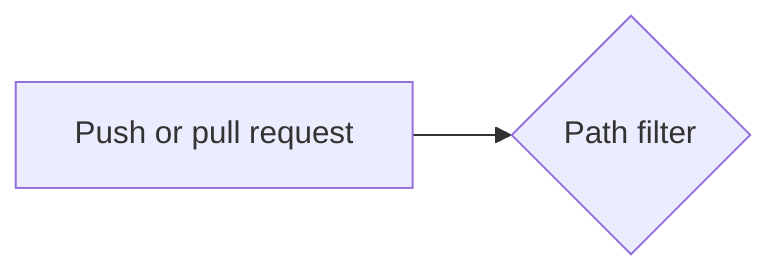

# Markdown and Mermaid

## What it is

Markdown is a plain-text way to write formatted documents: `#` for headings, `-` for bullets, backticks for code, `|` for tables. GitHub shows `.md` files as formatted pages. Mermaid is a text language for diagrams; GitHub draws a code block marked `mermaid` as a picture.

## Why this repository uses it

The task requires a detailed README, an architecture document with a diagram, decision records and this `tech/` folder. Plain text in the repository is reviewed in pull requests like code. Markdown is also what the workflow produces: the "slowest tests" table is Markdown written to the job summary page.

## Where it appears

| Path | What it does with Markdown |
| --- | --- |
| `README.md`, `ARCHITECTURE.md`, `CHANGELOG.md` | The documents. |
| `docs/index.md`, `docs/adr/*.md` | The documentation folder that the workflow ignores, and the decision records. |
| `ARCHITECTURE.md` | A fenced `mermaid` block with the data-flow diagram. |
| `pipeline/slowest_tests.py` | Builds a Markdown table as text for `$GITHUB_STEP_SUMMARY`. |
| `tech/*.md` | These notes. |

## How it works underneath

A Markdown file is just text. A renderer (GitHub's page, an editor preview) reads it line by line and turns the marks into formatting. Tables use `|` between cells and a second line of dashes; `---:` right-aligns a column. A fenced code block starts and ends with three backticks and can name a language after the opening fence. Mermaid is drawn in the reader's browser from the text in the block.

## Walkthrough of this repository's use

```python
lines = ["### Slowest tests", "", "| Test | Seconds |", "| --- | ---: |"]
lines += [f"| `{name}` | {seconds:.3f} |" for name, seconds in rows]
```

A heading, a blank line, a header row, the separator row, then one row per test. The result is appended to the file whose path is in `GITHUB_STEP_SUMMARY`, and GitHub renders it on the run page.

The diagram in `ARCHITECTURE.md` begins with:

````text

````

`flowchart LR` means a flow chart drawn left to right. `["text"]` is a box, `{"text"}` is a decision diamond, `-->` an arrow, `-. "label" .->` a dotted arrow. The nodes mirror the lesson's diagram names (path filter, matrix, dependency cache, test reports).

Docs-only changes are cheap on purpose: a commit that only touches `*.md` or `docs/` starts no test jobs (see `github-actions.md`).

## Try it yourself

1. Open `ARCHITECTURE.md` on GitHub (or in an editor with Mermaid preview) to see the diagram.
2. `.venv/bin/python -m pipeline.slowest_tests report.xml` (after `pytest --junitxml=report.xml`) prints a Markdown table.
3. `grep -n '^#' README.md` lists all headings.

## Mistakes people make

- A table row with a different number of cells than the header.
- Forgetting the blank line before a list or table, so it is shown as plain text.
- A code fence that is never closed, which swallows the rest of the page.
- Quotes inside Mermaid labels without quoting the label.

## Check yourself

1. How does GitHub draw a diagram from text? *(A `mermaid` fenced block is rendered by Mermaid.)*
2. What does `---:` do in a table? *(Right-aligns the column.)*
3. Where does the "slowest tests" Markdown go? *(`$GITHUB_STEP_SUMMARY`, shown on the run's summary page.)*
4. Why does a docs-only change start no tests? *(The workflow's `paths-ignore` lists `docs/**` and `**.md`.)*
5. What starts and ends a code block? *(Three backticks.)*

## Further reading

- GitHub Flavored Markdown spec: https://github.github.com/gfm/
- Mermaid flowcharts: https://mermaid.js.org/syntax/flowchart.html
