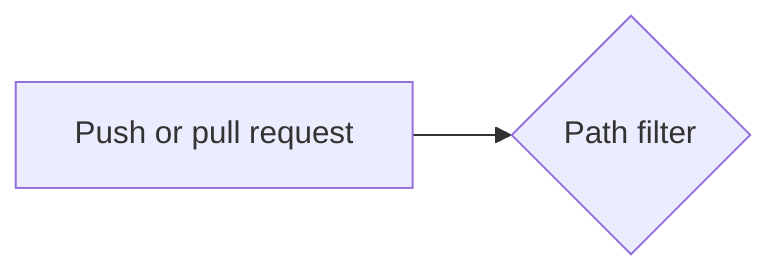

# Markdown and Mermaid

## What it is

Markdown is a plain-text way to write formatted documents: `#` for headings, `-` for bullets, backticks for code, `|` for tables. GitHub shows `.md` files as formatted pages. Mermaid is a text language for diagrams; GitHub draws a code block marked `mermaid` as a picture.

<!-- words -->

<details>
<summary><b>Words this note uses, in case they are new to you</b> (click to open)</summary>

- **commit**: A saved snapshot of a project's files in Git, with a message and an author. Every commit has a unique 40-character name (its SHA).
- **pull request**: A proposal on GitHub to merge the commits of one branch into another. People review it and automation checks it before it is merged.
- **workflow**: A GitHub Actions automation described in a YAML file under `.github/workflows/`. It names the events that start it and the jobs it runs.
- **dependency**: A package that your project needs in order to work.
- **cache**: A saved copy of something slow to produce (such as downloaded packages), kept so the next run can reuse it.
- **list**: An ordered collection of values written one after another.
- **folder**: A container for files and other folders on disk (also called a directory).
- **test**: A small program that uses your code and checks that the answer is the one you expected.
- **matrix**: In GitHub Actions, a list of values (for example operating systems and Python versions) from which GitHub starts one job for every combination.

</details>

<!-- /words -->

## Why this repository uses it

The task requires a detailed README, an architecture document with a diagram, decision records and this `tech/` folder. Plain text in the repository is reviewed in pull requests like code. Markdown is also what the workflow produces: the "slowest tests" table is Markdown written to the job summary page.

## Where it appears

| Path | What it does with Markdown |
| --- | --- |
| `README.md`, `ARCHITECTURE.md`, `CHANGELOG.md` | The documents. |
| `docs/index.md`, `docs/adr/*.md` | The documentation folder that the workflow ignores, and the decision records. |
| `ARCHITECTURE.md` | A fenced `mermaid` block with the data-flow diagram. |
| `pipeline/slowest_tests.py` | Builds a Markdown table as text for `$GITHUB_STEP_SUMMARY`. |
| `tech/*.md` | These notes. |

## How it works underneath

A Markdown file is just text. A renderer (GitHub's page, an editor preview) reads it line by line and turns the marks into formatting. Tables use `|` between cells and a second line of dashes; `---:` right-aligns a column. A fenced code block starts and ends with three backticks and can name a language after the opening fence. Mermaid is drawn in the reader's browser from the text in the block.

## Walkthrough of this repository's use

```python
lines = ["### Slowest tests", "", "| Test | Seconds |", "| --- | ---: |"]
lines += [f"| `{name}` | {seconds:.3f} |" for name, seconds in rows]
```

A heading, a blank line, a header row, the separator row, then one row per test. The result is appended to the file whose path is in `GITHUB_STEP_SUMMARY`, and GitHub renders it on the run page.

The diagram in `ARCHITECTURE.md` begins with:

````text

````

`flowchart LR` means a flow chart drawn left to right. `["text"]` is a box, `{"text"}` is a decision diamond, `-->` an arrow, `-. "label" .->` a dotted arrow. The nodes mirror the lesson's diagram names (path filter, matrix, dependency cache, test reports).

Docs-only changes are cheap on purpose: a commit that only touches `*.md` or `docs/` starts no test jobs (see `github-actions.md`).

### The three decision records, in plain words

An **ADR** (architecture decision record) is a short document that records one decision and why it was made, so nobody has to guess later. Each has `Status`, `Context`, `Decision`, `Alternatives considered` and `Consequences`.

**`docs/adr/0001-one-gate-job-and-a-companion-for-docs-only-changes.md`.** *Problem:* a workflow skipped by a path filter reports no check at all, so a required check from it stays "pending" and a documentation pull request could never merge; and the six matrix names are fragile to require, because adding a Python version outdates the list. *Decision:* `ci.yml` ends with one job `ci-ok` that `needs` every other job, runs with `if: always()` and fails when any of them failed or was cancelled (`pipeline/gate.py`); `ci-docs-only.yml` starts on the inverse filter and has a job also named `ci-ok` that succeeds; a test asserts the two names match and the two filters are inverses on sample changes. *Rejected:* not requiring the check (nothing stops a red merge); a `changes` job with `if:` on every job (starts a run even for documentation); requiring the six matrix names. *Consequence:* a change mixing documentation and code starts both workflows; this edge case needs a real GitHub repository to confirm, and the record says how.

**`docs/adr/0002-hash-pinned-universal-lock-files.md`.** *Problem:* the cache key is built from the lock file's hash, so the lock must be one file for every matrix cell and change only when a dependency changes; a plain `pip freeze` is specific to one machine. *Decision:* `requirements.in` and `requirements-dev.in` list direct dependencies with exact versions; `uv pip compile --universal --generate-hashes --python-version 3.10` makes the locks, with environment markers and SHA-256 hashes; every install uses `pip install --require-hashes`. *Rejected:* unhashed pins; `uv sync` with `uv.lock` (uv is used only to compile). *Consequence:* changing a dependency means editing the `.in` file and recompiling; the cache misses once, which proves the key follows the lock.

**`docs/adr/0003-measure-each-stage-with-its-own-workflow.md`.** *Problem:* measuring four stages by editing `ci.yml` and pushing commits mixes stages in the history. *Decision:* three workflows that run only on `workflow_dispatch` hold the first three stages (`measure-1-plain.yml`, `measure-2-matrix.yml`, `measure-3-cache.yml`); the fourth is `ci.yml`; `make measure` and `pipeline/billing.py` produce the table row. *Rejected:* one workflow edited per stage; reading the billing page (aggregated by day). *Consequence:* the measurement workflows duplicate most of `ci.yml` on purpose; real numbers need real GitHub runners, so the repository ships the tool and a fixture-based example, not invented numbers.

### The other documents

`docs/index.md` is the folder the path filter ignores (editing it must not start the test workflow). `CHANGELOG.md` lists what changed in each version. `README.md` is the front page; `ARCHITECTURE.md` explains the parts. `LICENSE` is the MIT license, a short legal text that lets anyone use and change the code as long as the notice is kept.

## Try it yourself

1. Open `ARCHITECTURE.md` on GitHub (or in an editor with Mermaid preview) to see the diagram.
2. `.venv/bin/python -m pipeline.slowest_tests report.xml` (after `pytest --junitxml=report.xml`) prints a Markdown table.
3. `grep -n '^#' README.md` lists all headings.

## Mistakes people make

- A table row with a different number of cells than the header.
- Forgetting the blank line before a list or table, so it is shown as plain text.
- A code fence that is never closed, which swallows the rest of the page.
- Quotes inside Mermaid labels without quoting the label.

## Check yourself

1. How does GitHub draw a diagram from text? *(A `mermaid` fenced block is rendered by Mermaid.)*
2. What does `---:` do in a table? *(Right-aligns the column.)*
3. Where does the "slowest tests" Markdown go? *(`$GITHUB_STEP_SUMMARY`, shown on the run's summary page.)*
4. Why does a docs-only change start no tests? *(The workflow's `paths-ignore` lists `docs/**` and `**.md`.)*
5. What starts and ends a code block? *(Three backticks.)*

## Further reading

- GitHub Flavored Markdown spec: https://github.github.com/gfm/
- Mermaid flowcharts: https://mermaid.js.org/syntax/flowchart.html
